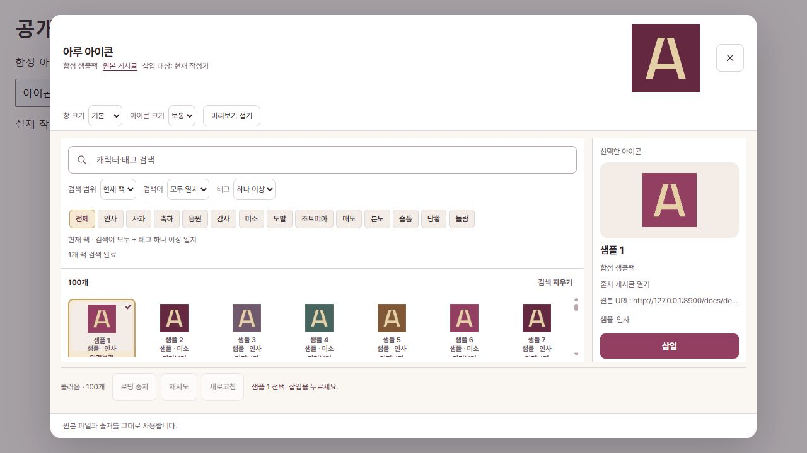

# Aru Source Captioner

루리웹 작성기에 첨부한 이미지의 **픽시브 파일명과 메타데이터를 읽어 출처를 기재**하는 브라우저 확장 프로그램입니다. EXIF·XMP·IPTC·PNG iTXt의 출처 정보와 픽시브 파일명 패턴을 사용하며, 확인할 수 있는 출처가 없으면 캡션을 추가하지 않습니다.

공개 후보의 기준은 **Design Polish RC3**, 확장 Manifest 버전은 **0.1.2**입니다. 공개용 빌드는 권한이 확인되지 않은 캐릭터 그림을 직접 만든 기하학 플레이스홀더로 대체합니다. 원본 아이콘팩 파일은 포함하지 않습니다. 이 저장소는 루리웹·픽시브의 공식 제품이 아닙니다.

## 주요 기능

- 파일명·메타데이터 기반 이미지 출처 캡션.
- 루리웹 공개 아이콘 게시글과 통합팩 탐색, 태그 검색·필터, 미리보기.
- 댓글·답글·게시글 작성기의 아이콘 삽입. PC에서는 더블클릭 삽입도 지원합니다.
- 이미지·동영상의 고정 태그 13개와 자유 태그 편집.
- 공개 게시글 참조를 이용한 통합팩 구성, 제목 검색과 일괄 추가.
- 98번 게시판의 본문 이미지·MP4 등 미디어 일괄 다운로드.

아이콘 관련 기능은 기본 OFF입니다. 확장 설정에서 활성화한 뒤 사용합니다. 저장된 태그·팩 데이터의 규격은 기존 `aru-tags:v1`·`ruricon:v1`을 유지합니다. 게시글과 댓글을 자동 등록하지 않습니다.

## 지원 환경

| 브라우저 | 로드 폴더 | 범위 |
|---|---|---|
| Chrome · Edge · Whale | `whale/` | Chromium MV3, PC 우선 |
| Firefox | `firefox/` | Manifest 최소 버전 140 |
| Android Firefox | `firefox/` | Manifest 최소 버전 142, 모바일 정식 검증 미완료 |

공개 후보는 로컬 빌드·정적 검사·테스트 DOM으로 검증합니다. 실제 확장 설치 및 루리웹 연동은 [수동 검증 절차](docs/MANUAL-TESTING.md)를 확인하세요. 스토어 게시 URL과 심사 완료 상태는 아직 이 문서에 등록하지 않았습니다.

## 설치와 개발

Node.js 24와 npm, Git이 필요합니다. 설치에 API 키나 로그인 쿠키는 필요하지 않습니다.

```sh
git clone https://github.com/sdh-dot/aru-source-captioner.git
cd aru-source-captioner
npm ci --ignore-scripts
npm run build
npm run verify
npm test
```

로컬 공개 소스 폴더에서도 동일한 npm 명령을 사용할 수 있습니다.

### Chrome · Edge · Whale

1. 각각 `chrome://extensions`, `edge://extensions`, `whale://extensions`를 엽니다.
2. 개발자 모드를 켜고 **압축해제된 확장 프로그램 로드**로 `whale/`를 선택합니다.
3. 사용 중인 스토어 확장과 동시에 활성화하면 중복 동작할 수 있으므로 별도 테스트 프로필을 권장합니다. 기존 프로필·설정은 초기화하지 마세요.

### Firefox

`about:debugging#/runtime/this-firefox` → **임시 부가 기능 로드** → `firefox/manifest.json`을 선택합니다. 임시 설치는 브라우저 종료 시 해제됩니다. 일반 Firefox에서 ZIP만으로 영구 설치되는 것은 아니며 서명된 배포가 별도로 필요합니다.

[재현 가능한 빌드와 Mozilla 제출 절차](docs/BUILD.md)에서 빌드 입력·검증·패키징 범위를 설명합니다.

## 사용 방법

이미지를 루리웹 글쓰기 화면에 첨부하면 원본 파일과 본문 이미지를 연결해 출처를 읽습니다. 옵션에서 자동 캡션과 허용 호스트 정책을 조정할 수 있습니다. 옵션을 바꾼 후에는 새 테스트 탭을 사용하세요.

아이콘 기능을 켜면 기본 아이콘 버튼 옆의 **아이콘 선택**에서 팩을 고를 수 있습니다. 한 번 클릭하면 선택·미리보기, **삽입** 또는 마우스 더블클릭으로 작성기에 반영합니다. 게시글 툴바의 **아이콘 태그**와 **아이콘 통합**은 지원되는 작성·수정 화면에 표시됩니다. 실제 등록은 루리웹 기본 버튼으로 직접 수행합니다.

Native Host가 필요한 다운로드 후 메타데이터 기록은 별도의 Aru Archive 데스크톱 구성 요소가 설치된 경우에만 사용할 수 있습니다. 확장 자체에는 Native Host 실행 파일이나 사용자 환경 등록 파일을 포함하지 않습니다.

## 화면



위 화면은 공개 빌드의 실제 선택기 코드에 합성 팩을 공급한 로컬 렌더링입니다. 사용자 댓글·로그인·제3자 캐릭터 이미지는 포함하지 않았으며, 실제 루리웹 설치 검증 화면으로 취급하지 않습니다.

## 권한

| 권한 | 사용 목적 |
|---|---|
| `storage` | 옵션·아이콘 기능 설정·크기 설정·캐시 관리 |
| `downloads` | 사용자가 요청한 미디어 저장과 다운로드 완료 확인 |
| `contextMenus` | 본문 다운로드의 진입 메뉴 |
| `nativeMessaging` | 설치된 Aru Archive Native Host에 다운로드 메타데이터 기록 요청 |
| 루리웹 호스트 | 지원되는 읽기·작성·수정 화면 및 i1/i2/i3 미디어 조회 |

픽시브 사이트에 로그인하거나 비공개 정보를 요청하지 않습니다. 파일명에서 작품 URL을 만들고 원본 파일의 메타데이터를 로컬에서 읽습니다. 전체 권한 범위는 각 `manifest.json`이 기준입니다.

## 제한과 검증 상태

- 사이트 작성기 DOM/API 변경은 출처 연결이나 삽입 기능에 영향을 줄 수 있습니다.
- 삭제·접근 제한 게시글이나 미디어는 우회 수집하지 않습니다.
- MP4·WEBM 미리보기는 브라우저 디코더와 응답 상태에 따라 실패할 수 있습니다.
- 모바일·터치 환경의 정식 지원 검증은 완료되지 않았습니다.
- 역사적 테스트는 외부 이전 버전 비교와 오래된 UI 가정을 포함합니다. 실패를 제거하지 않았습니다. [검증 기록](docs/VALIDATION.md)을 확인하세요.

## 버그 제보와 기여

[Issues](https://github.com/sdh-dot/aru-source-captioner/issues)에 재현 절차·브라우저 버전·최소 오류 코드를 남겨 주세요. 취약점은 [SECURITY.md](SECURITY.md)의 비공개 경로로 제보합니다. 개인정보나 인증 정보를 공개 Issue에 첨부하지 마세요.

누구나 Fork에서 수정하고 PR로 제안할 수 있습니다. 원본 저장소에 대한 쓰기 권한은 소유자와 승인된 Collaborator에게만 부여합니다. [기여 가이드](CONTRIBUTING.md)와 [변경 이력](CHANGELOG.md)을 확인하세요.

## 라이선스

자체 소스·문서·공개용 기하학 플레이스홀더에는 [MIT License](LICENSE)를 적용합니다. 이 라이선스는 제3자 저작물·제외된 캐릭터 에셋·외부 아이콘팩에 적용되지 않습니다. exifr의 원래 MIT 고지와 Pretendard의 SIL OFL 1.1 조건은 별도로 유지합니다. [제3자 고지](THIRD_PARTY_NOTICES.md)를 확인하세요.
