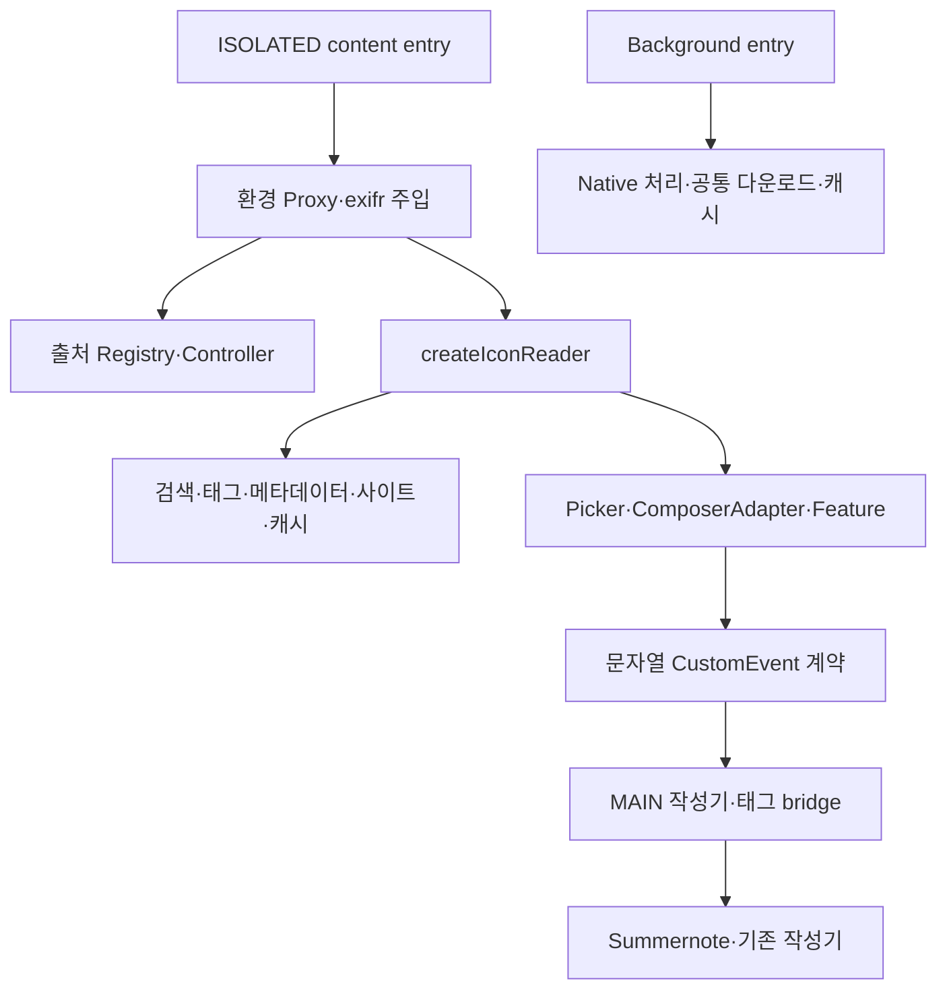

# WXT·TypeScript 코드 품질 및 아키텍처 점검

2026-10-17, Asia/Seoul. 기준은 PR #6의 `integration/aru-wxt`, `b1c22e71537a0151999d136d8105eb0d0696790f`다. 시작 시 원격 HEAD·로컬 HEAD가 같고 통합 Worktree가 clean임을 확인했다. 별도 `refactor/wxt-code-quality` / `wxt-code-quality` Worktree에서 조사·개선했다. 기존 브랜치·PR·미커밋 작업은 변경하지 않는다.

**결론:** 기능별 Core·어댑터·World 분리는 이미 존재한다. 큰 파일 전체를 다시 나누기보다 Runtime 연결 계약, Picker 자원 소유권, 외부 메타데이터 검증 경계를 명확히 하는 것이 우선이다. 새 P0 오연결·데이터 손상은 확인하지 않았다. 문자열이 아닌 PNG `artwork_id`의 예외는 오프라인으로 재현했으며 입력 정책 변경이 필요해 P1 후속 항목으로 남겼다.

코드 위치는 아래에 별도 표기가 없으면 **기준 커밋의 줄 번호**다. 이번 타입·주석 변경으로 최신 줄 번호는 다를 수 있다. [설계](refactoring-design.md)와 [적용·검증 결과](refactoring-results.md)를 함께 읽는다.

## 1. 조사 범위와 근거

- `src/**/*.ts` 59개, WXT `entrypoints/`, 환경 연결 `runtime/`, Manifest 설정 `config/`를 구분했다. `docs/source/**/*.mjs`, classic JavaScript, `.output/`은 생성물이다. vendor 내부 IIFE는 변경 대상이 아니다.
- TypeScript AST 조사에서 기준 원본은 27,259개 물리 줄, 명시적 `any` 555개, `DynamicApi` 타입 참조 95개였다. 암묵적 `any`나 전이된 동적 타입까지 센 값이 아니며 결함 개수도 아니다. Picker는 3,452줄, Firefox Content 1,846줄, Whale Content 2,236줄이다. CSS 문자열·타입·주석을 포함하므로 길이만으로 분리하지 않는다.
- 함수·import 조사, 주요 초기화/종료·비동기 흐름 직접 읽기, 생성물 비교, 실제 TypeScript 음성 컴파일 검사를 사용했다. 모든 실행 분기와 실제 사이트 상태를 완전 탐색한 감사는 아니다.
- `docs/maintenance/source-quality-review.md`·`refactoring-plan.md`의 과거 ESM 분석을 재사용하되 당시 줄 수·경로·WXT 미통합 판단을 현재 구현으로 대체했다. 과거 원문은 수정하지 않았다.
- 작업 경로와 상위 경로에 적용되는 `AGENTS.md`가 없고, 현재 추적 파일에 `CODING_STANDARDS.md`, `GIT_COLLABORATION.md`, 과거 `iife-wxt-code-quality-guidelines.md`도 없었다. 현재 `CONTRIBUTING.md`, 코드의 보존 규칙, 이번 사용자 지침을 적용했다. 없는 지침을 읽었다고 간주하지 않는다.

## 2. 실행 구조와 초기화 순서

`entrypoints/ruliweb-icons.content.ts`는 환경 → 출처 Core → 브라우저 installer → 아이콘 Runtime → 같은 ISOLATED World의 상태 연결 → 출처 UI 순서다. 다른 `MAIN` entry가 작성기·태그 bridge를 설치한다. `runtime/world-state.ts`의 Symbol 상태는 동일 ISOLATED 실행 영역의 공개 인스턴스 연결용이며 MAIN과 객체를 직접 공유하지 않는다. 이벤트 이름·세션·요청 ID·직렬화 검사는 별도로 유지한다.

`src/runtime/icons.ts:51`의 순서는 base(검색·메타데이터·Browser/Site Adapter) → Registry → Catalog → DesignSystem → LibrarySearch → LibraryReader → UiPreferences → Picker → ComposerAdapter → Feature다. Catalog가 DesignSystem보다 먼저, Picker가 ComposerAdapter보다 먼저 만들어져 **지연 resolver가 필요**하다. 단순 객체 전개나 순서 재배치는 동등하지 않다.

`createMetadataUi:168`, `createBundleMain:200`, `createBundleUiRuntime:237`는 별도 진입점이다. 기존 Metadata 인스턴스를 재사용해 `MetadataError` 클래스 식별성을 보존한다. 반환값을 다시 합치지 않는 bridge factory 호출도 리스너 설치를 수행하므로 미사용 호출로 삭제하지 않는다.

`entrypoints/background.ts`는 플랫폼 Native 처리 → 아이콘 캐시 → 공통 다운로드를 설치한다. Native 완료 처리의 `ownsDownload`는 이후 조립되는 다운로드 API를 늦게 조회한다. `src/runtime/downloads.ts:12,49`의 Background/Content 조립은 Core → Browser API 이후 각각 Background 또는 Extractor·Content로 갈라진다. 다운로드 실행·원장 복구는 별도 관리 UI/Engine 책임이다.

## 3. Picker의 함수별 책임과 호출 관계

| 기준 위치·함수 | 책임·흐름 | 상태·부작용 및 안전한 분리 후보 |
| --- | --- | --- |
| `picker.ts:29` `createIconsPicker` | 환경·resolver → 기능 설치 → 공개 함수 3개 선택 | import만으로 DOM을 만들지 않음. 이번에 의존성 키 계약을 추가 |
| `:302` `createPicker` | Shadow DOM·컨트롤·상태·자원 구성 | 선택·검색·레이아웃·수명 소유가 한 클로저에 모임. 새 범용 Controller 도입보다 경계별 계약 우선 |
| `:118` `lockPage` | 문서별 여러 Picker의 overflow 잠금 참조 수 관리 | 마지막 창 종료 때 원래 스타일 복원. 인스턴스별 단순 unlock으로 대체 금지 |
| `:207` `mediaUrl`, `:252` `articleUrl` | 미디어·출처 링크 검증 | Metadata 위임·로컬 Fixture 예외·환경 URL에 의존. 이름이 비슷한 다운로드 URL 검증과 합치지 않음 |
| `:1199` `createMedia`, `:1137` `mediaDiagnostic` | 이미지/동영상·프레임·실패·재시도·미리보기 | mediaBudget·previewState·cleanup·DOM 생존 여부와 결합. MediaSession 후보지만 즉시 추출 보류 |
| `:1446` `select`, `:1962` `renderSelection` | 선택 ID → 표시·태그·미리보기·삽입 가능 상태 | 선택과 실제 삽입 대상의 대응 유지. PickerIcon/PreviewState로 부분 타입화됨 |
| `:1471` `makeCard` | 카드 UI·포인터·미리보기 이벤트 | 신뢰된 마우스 double click과 터치 분기 유지 |
| `:1679` `renderWindows`, `:2020` `renderGroups` | 가상 창 계산 → 그룹·카드 배치 | 최대 카드 72, visibility/resize observer·RAF. 먼저 입력/출력이 명확한 행 계산만 분리 후보 |
| `:1909` `renderChips` | 사전/이미지 태그 표시와 선택 필터 | 검색 정규화와 저장 태그 정규화를 혼합하지 않음 |
| `:2419` `renderLibrary`, `:2543` `libraryCollect` | 수집·진행 → 검색 결과 표시 | 종료 후 진행 RAF·Promise 결과의 갱신을 차단함 |
| `:2568` `applySearch` | queryRevision·검색 상태 → Library/SearchIndex → 렌더링 | `lifecycle.isClosed` 선행 검사. 디바운스·IME·scope 변경과 함께 검증 필요 |
| `:2818` `applyUi`, `:2914` `uiReady` | 크기·미리보기 설정과 비동기 복원 | 닫힌 Picker 또는 사용자 변경 이후 늦은 저장소 응답이 덮어쓰지 않도록 uiRevision 검사 |
| `:3075` `requestInsertion` | 선택·타깃·미리보기·중복 실행 검사 → onSelect | 외부 작성기 callback·실패 표시·preparing 복원. MAIN 계약 변경과 분리 불가 |
| `:2725` `destroy`, `:2728` `disposePicker` | Lifecycle 종료 확정 → 자원 해제 | 이벤트 AbortController, 검색/토스트 타이머, RAF, preview, library, observer, 미디어, Catalog, scroll lock, 포커스 복원 |
| `:3388` `getSnapshot` 및 setter | 기존 기능/진단/테스트용 공개 제어 | element·shadowRoot 노출은 기존 API. 무조건 비공개화하지 않으며 추후 명시적 handle/진단 DTO 타입 후보 |

`PickerLifecycle`은 종료를 먼저 확정하고 재진입·중복 destroy를 차단한다. 이벤트는 공용 AbortSignal, 미디어는 개별 cleanup, Library는 자체 취소를 사용한다. 이 세 수명을 하나의 generic cancellation 객체로 합치면 실제 파서 중단과 UI 종료를 혼동하기 쉽다.

`disposePicker`는 순차 호출이므로 주입 cleanup이 예외를 던지면 후속 해제가 실행되지 않을 정적 위험이 있다. 현재 실제 브라우저에서 그런 실패를 확인한 것은 아니다. 기존 Lifecycle의 “닫힘 확정” 테스트를 “모든 자원이 반드시 해제됨”의 증명으로 해석하지 않는다.

## 4. Firefox·Whale Content

| 경계 | 현재 책임·의존성 | 보존 및 개선 판단 |
| --- | --- | --- |
| `loadConfig` FF154 / WH148 | storage.sync 가용성·callback 오류 → 기존 기본값 | Chrome/Firefox 호환 경계. 옵션은 초기화 시 조회하며 live 변경 구독은 없음 |
| `parseSourceFromFile` FF374 / WH379 | PNG iTXt → 브라우저별 파일명/메타데이터 정책 | **FF 파일명 우선·`chunked:false`, WH 메타데이터 우선·기존 청크 옵션** 유지 |
| PNG·후보 수집 | ARU iTXt, EXIF/XMP/IPTC, 가능한 JSON, 문자열 재귀 | PNG 바이트 도구와 Pixiv 파일명은 이미 공통 모듈. 후보 수집·외부 JSON 검증은 여전히 중복 |
| `sanitizeSourceUrl` FF732 / WH714 | raw 후보 → URL·scheme·허용 호스트 검증 | `ParsedSourceResult.url: string`은 안전 URL 보증이 아님. 런타임 검증 필수 |
| `startEditorObserver` FF797 / WH1046 | Core Controller에 parse/sanitize/caption/root 정책 주입 | 같은 함수 본문이어도 호출하는 브라우저 파서가 다름. 선택 순서나 img.src로 대응 추정 금지 |
| 댓글 입력·관찰 FF1209/1366, WH1592/1757 | WeakMap·WeakSet, 늦은 댓글 DOM, polling | Whale 출처 버튼·픽셀 표 등 차이 존재. 페이지 수명과 반복 installer 호출 계약부터 고정 필요 |
| installer 종료 | pagehide에서 업로드 Controller.destroy, installer 반환 `{}` | document change·댓글 watcher까지 포괄하는 명시적 disposer는 없음. 일반 문서 종료와 WXT 재설치를 구분해 조사할 항목 |

두 Content 파일의 같은 이름 함수 중 **주석·타입을 제외한 독립 함수 본문 51개가 일치**했다. 이 수에는 중첩 `attempt`, DOM·옵션·상태를 캡처하는 함수도 들어간다. 51개를 바로 순수 모듈로 추출할 수 있다는 뜻이 아니다. `startEditorObserver`도 같은 본문에서 서로 다른 `parseSourceFromFile`을 호출하므로 closure 의존성까지 확인해야 한다.

### 재현한 P1: 외부 artwork_id 자료형

기준 [Firefox `content.ts:360`](https://github.com/sdh-dot/aru-source-captioner/blob/b1c22e71537a0151999d136d8105eb0d0696790f/src/platform/firefox/content.ts#L360), [Whale `content.ts:365`](https://github.com/sdh-dot/aru-source-captioner/blob/b1c22e71537a0151999d136d8105eb0d0696790f/src/platform/whale/content.ts#L365)의 `extractSourceFromAruArchivePayload`는 `(payload.artwork_id || "").trim()`을 사용한다. 외부 JSON을 TypeScript 타입만으로 신뢰할 수 없다.

| 입력 artwork_id | 양쪽 함수의 오프라인 결과 |
| --- | --- |
| `"143805797"` | ok, `https://www.pixiv.net/artworks/143805797` |
| `143805797` | TypeError: `.trim is not a function` |
| `{ "id": "143805797" }` | 같은 TypeError |
| `null` | missing, `png_itxt_no_url` |

실제 현재 함수 본문을 추출해 실행한 결과이며 서버 업로드·브라우저 성공을 흉내 낸 검증이 아니다. `collectFromPossibleAruJson` FF627/WH609에도 같은 패턴이 있지만 해당 전체 경로를 별도로 실행한 결과로 확대하지 않는다. 출처 오연결은 확인하지 않았다. 숫자를 문자열 ID로 허용할지, 잘못된 자료형을 missing으로 거절할지 결정해야 하므로 이번 동작 보존 범위에서는 수정하지 않았다. 새 반환 타입도 Promise의 예외 발생 자체를 막지는 않는다.

## 5. 나머지 핵심 기능과 의존 경계

| 영역·코드 | 데이터 흐름·책임 | 유지보수 판단 |
| --- | --- | --- |
| `runtime/contracts.ts`, `module-scope.ts` | 환경·factory → eager own 값 / late getter → 선택 export | DynamicApi·환경의 문자열 index는 남음. 이번에는 타입 인자와 Picker의 유한 키부터 강화. own 값의 identity와 export가 조회 당시 값인 의미를 보존 |
| `icon-metadata/tag-codec.ts`, `tag-edit-model.ts` | 외부 tags → 검증/정규화 → 이미지별 plan·Selection | 첫 순서·대소문자·no-op rawTags·미선택 ID 보존. 순수 모델로 잘 분리돼 있고 검색 NFKC와 공통화 금지 |
| `bundle-generator/core.ts`, `client.ts`, `bridge.ts`, `search*.ts` | Draft·unknown 필드 보존 → 미리보기/검증 → MAIN apply | `ruricon:v1`, 참조 순서, inert HTML 파싱, history/serializer 실패 복원을 유지. 브리지 중간 계층을 단순 wrapper로 삭제하지 않음 |
| `ruliweb-icons/core.ts`, `library-search.ts` | SearchIndex → LibrarySearchEngine의 통합 행·태그·검색 캐시 | 결과 캐시 32개·revision/AbortSignal·partial 상태 명시. 취소 후 ensure 검사를 유지해야 함. 고정 태그 13개 목록의 중복은 후속 후보 |
| `library-reader.ts`, `site-adapter.ts` | cache → 공개 본문/메타데이터 수집 → snapshot | 캐시 쓰기 실패가 실제 공개 팩 조회 실패로 전파되지 않게 설계. Browser/Site 포트가 any여서 타입 추적은 부족 |
| `browser-adapter.ts`, `ruliweb-icons/background.ts` | callback/Promise·JSON 바이트 carrier → message/IDB | 송수신 양쪽 검증은 필요. carrier 재귀 공통화 전 허용 타입·상한·오류 분류 비교 필요. IDB generation과 직렬 큐는 유지 |
| `upload-attribution/core.ts:85,153,503,572,592,625,777` | Registry begin/ready/match/commit; 선택 → 2슬롯 parser → reconcile → destroy | 같은 File 객체의 진행 중 작업만 공유. 동명 파일 합치기·FIFO 대체 금지. destroy는 대기자 해제이며 이미 시작한 exifr 작업의 실제 취소가 아님 |
| `upload-attribution/models.ts` | parser 결과와 큐 상태를 공유하던 느슨한 모델 | 이번에 판독 전용 union을 추가. Registry record/state·snapshot의 공개 가변 상태는 후속 타입/캡슐화 대상 |
| `composer-adapter.ts`, `composer-bridge.ts`, `metadata-editor-bridge.ts` | ISOLATED 선택 → 문자열 요청 → MAIN 대상/세션/본문 재검증 | 1MiB detail 제한·request ID·target·TTL·history·동기 응답 보존. 이벤트 ID는 타입 선언만으로 검증되지 않음 |
| `body-download/core.ts`, `browser-api.ts`, `engine.ts`, `background.ts` | 미디어 검증 → job 원장 → 사용자 시작 → 저장·취소·복구 | 작은 다운로드는 완료 리스너를 download 응답 전에 설치. finally에서 listener·Blob URL 해제. any 포트 축소는 가능하나 원장/취소 재작성은 보류 |
| `platform/*/background.ts` | 설치 기본값 보강·선택적 Native Host·다운로드 완료 처리 | `ownsDownload` 늦은 조회로 일반 일괄 다운로드 원본을 Native 경로에서 제외. 호스트 ID·옵션·확장 ID·권한 유지 |
| `platform/*/options.ts`, `ui-preferences.ts` | sync 옵션 / local Picker UI 설정 | 저장 키·기본값·callback/Promise·직렬 쓰기가 다름. 공통 storage 클래스 하나로 합치지 않음 |

## 6. 우선순위와 적용 판단

| 우선순위 | 항목 | 근거 수준·이번 처리 |
| --- | --- | --- |
| P1 | 외부 JSON artwork_id 타입 검증 | 함수 수준 예외 재현. 정책 결정 후 수정하도록 보류 |
| P1 | Runtime의 문자열 키·느슨한 반환 계약 | 확인된 타입 추적 문제. generic 계약·Picker 연결 이름·선택 export 타입 적용 |
| P1 | Picker 렌더·검색·미디어·종료 책임 집중 | 실제 호출·자원 목록 확인. 경계 설계만 완료, DOM 책임 이동 보류 |
| P1 | Content installer 전체 수명·재설치 | 반환 disposer/통합 해제 경계 부재 확인. 실제 중복 설치·BFCache 장애는 미검증 |
| P2 | Content 파싱 중복·carrier 중복 | 본문 일치 또는 같은 책임 확인. 캡처 상태·오류 정책·브라우저 차이로 추출 보류 |
| P2 | Registry·다운로드·사이트 포트 타입 | 공개 상태·any 경계 확인. 큐·history·원장 기능은 보존 |
| P3 | 과거 Phase·기계적/영어 주석 | 현재 제약 설명으로 한정 정리. 로그 문자열·식별자는 유지 |

새 class·factory·공통 dispatcher·전역 singleton을 추가하지 않았다. 새 동작이 필요한 항목은 [후속 설계](refactoring-design.md)에 API·브라우저·검증 영향을 명시했다. 감사에서 재현하지 않은 위험을 실제 장애로 판정하거나, 기존 MULTI-01 검증을 이번 실제 사이트 PASS로 재표기하지 않는다.
