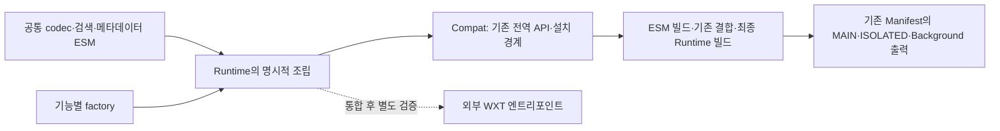

> 보존 기록: `chore/repository-cleanup`의 `282ff66f13d16ee7238d6070cb1983f58655e969`에서 선택적으로 가져왔다. 아래 수량·경로·미실행 사항은 당시 기준이며, 현재 TypeScript/WXT 구현과 검증은 [통합 보고서](../architecture/wxt-unification-report.md)를 따른다.

# 주요 소스 품질 검토

2026-10-16. 대상은 `integration/aru-unified`의 `183784c52be8916bc764626c6bbcbec104816eba`다. 로컬 통합 Worktree의 `323a3fd`와 제품 코드는 같고 README 안내만 추가됐다. 이번 작업은 소스 읽기·AST 구조 조사·기존 검증이며 제품 코드·주석·생성물은 수정하지 않았다. 줄 수는 LF로 나눈 물리 줄 수이므로 책임의 크기나 결함 개수를 뜻하지 않는다.

[정리·보존 근거](repository-cleanup-report.md)와 [구현 계획](refactoring-plan.md)을 함께 읽는다. 공개 API의 실제 import 예제와 World 경계는 [WXT 통합 안내](../architecture/esm-wxt-integration.md)를 따른다.

## 1. 소스와 실행 경계

관리 원본은 `shared/icon-metadata/*.mjs`, `docs/source/**/*.mjs`, `pack-registry.json`, CSS·HTML·에셋이다. `.mjs`라는 이유만으로 모두 순수 함수인 것은 아니다. `compat`는 전역 등록과 설치를 수행하고 기능 factory 일부는 호출 중 리스너·관찰자를 설치한다.

`tools/build-esm.mjs`는 Compat 출력 52개를 만들고 기존 `tools/build.mjs` → `docs/tools/build-generator.mjs` 결합 단계를 실행한 후 runtime 출력 8개를 생성한다. 출력 목록은 서로 겹치므로 이를 더해 고유 파일 수로 계산하지 않는다. 감사에서 분류하는 생성 JS는 68개다. 최종 번들의 IIFE는 배포 호환 수단이며, 관리 원본 IIFE는 0개다. `docs/source` 아래의 생성 JS도 삭제하면 중간 결합 단계와 역사적 harness가 깨진다.

현재 의존성 감사는 ESM 모듈 50개, 정적 순환 0개다. Compat·지연 resolver의 실행 순서까지 무조건 안전하다는 뜻은 아니다. WXT PR #5의 대상은 `refactor/esm-core-transition`이며 통합 브랜치와 다르다. 이 검토에서 PR #5 소스·설정·엔트리포인트를 수정하거나 가져오지 않았다.

## 2. 기능별 진입점과 데이터 흐름

| 영역 | 주요 진입점·책임 | 호출 관계와 데이터 흐름 | 부작용·외부 의존성 | 보존 규칙·WXT 영향 |
| --- | --- | --- | --- | --- |
| 태그 코덱·편집 모델 | `shared/icon-metadata/tag-codec.mjs`: `normalize/decode/encode/fail`; `tag-edit-model.mjs`: `plan/Selection` | rawTags → decode → 이미지별 변경 계획 → MAIN에서 적용. `Selection`은 인스턴스별 Set·anchor | 코덱은 DOM·저장소 미사용. `plan`의 ID 생성 콜백은 외부 주입이므로 함수 전체를 무조건 무부작용이라 부르지 않음 | 저장 태그는 검색 NFKC·소문자화와 다름. 첫 순서·대소문자·변경 없는 rawTags·미선택 ID·예외 코드를 보존. WXT에서 직접 import 가능 |
| 검색·필터·색인 | `ruliweb-icons/core.mjs`: `SearchIndex/FoldState`; `library-search.mjs`: `LibrarySearchEngine` | 팩 → 필드·태그 역색인 → 조건별 행/그룹 → UI. 다중 팩의 동일 아이콘은 identity로 연결 | 검색 모델 캐시·수집 AbortController·주입 reader; DOM 렌더링과는 분리 | 검색 normalize와 저장 normalize를 합치지 않음. 원래 순서·그룹 membership·32개 결과 캐시·partial/stale·취소 revision 유지 |
| 공개 팩 수집·메타데이터 | `site-adapter.mjs`: `NativeLoadSession/readArticlePack`; `metadata.mjs`: `createMetadata`; `metadata-core.mjs`: `validateV2`; `library-reader.mjs`: `LibraryPackReader` | 공개 DOM/캐리어 → metadata 검증 → NORMAL/BUNDLE 모델 → cache → 검색 | 공개 문서 요청·네이티브 추가 버튼·AbortSignal·BrowserAdapter cache | 본문 범위·URL·태그 원문·접근 거절 정책 유지. 태그 오류 시 유효 미디어를 보존하고 partial을 전파. 실 사이트 변경 시 독립 검증 |
| 통합팩 | `bundle-generator/core.mjs`: `Draft/validate/preserveUnknown`; `search.mjs`; `client.mjs`; `bridge.mjs` | 공개 검색/원본 검증 → Draft → encode → preview 세션 → MAIN apply | 공개 fetch·template 파싱·local draft·브리지 이벤트·Summernote | `ruricon:v1`·unknown 필드·참조 순서 보존. 조회 HTML은 연결하지 않은 template에서 파싱. 검색·UI·MAIN을 한 World로 합치지 않음 |
| 이미지 출처 매칭 | `upload-attribution/core.mjs`: `Registry.begin/ready/match/commit`, `Controller.reconcile`; `platform/*/content.mjs`: `parseSourceFromFile/sanitizeSourceUrl` | File 선택 → parser → Registry → 작성기 이미지 속성 증거 → 캡션 위치 검증 → commit | exifr·PNG iTXt·DOM·사용자 옵션·허용 호스트 | 이름·root·가능 출처 일치가 근거. src는 업로드 준비 상태 확인용이며 원본 식별 근거가 아님. FIFO나 본문 끝 삽입 대안으로 바꾸지 않음 |
| DOM 감시·파싱 큐 | `upload-attribution/core.mjs`: `Controller.discover/select/parseFile/drainParsers/destroy`; `ui.mjs` | root 발견 observer → root별 이미지 observer → microtask reconcile. 여러 배치 → 공용 2슬롯 parser | MutationObserver·AbortController·파서 Promise·File 객체 identity | 동일 불변 File의 진행 중 작업만 공유. 동명 파일을 합치지 않음. destroy가 대기자를 해제해도 이미 시작한 파서 자체가 중단됐다는 의미는 아님 |
| 브라우저 API·캐시 | `browser-adapter.mjs`: `invoke/carrierBytes/requestCache`; `background.mjs`: `handle/execute/openDatabase` | 옵션·cache 요청 → runtime message → 발신자/기능 상태 검증 → 직렬 큐/IndexedDB → 응답 | Promise/callback·runtime.lastError·storage 변경·IndexedDB·확장 수명 | Chromium JSON 바이트 carrier·요청 type/action·저장 키·generation 무효화 유지. Background 설치와 content API 역할을 분리 |
| MAIN/ISOLATED 작성기 | `metadata-editor-bridge.mjs`: `scan/preview/apply/history`; `interface.mjs`: `Client/Panel/Controller`; `composer-adapter.mjs`, `composer-bridge.mjs` | UI 선택 → 문자열 이벤트 요청 → MAIN에서 대상/세션 재검증 → 속성/삽입 → history·serializer 확인 → 응답 | Summernote·seditor·네이티브 삽입 API·CustomEvent·DOM | 동기 응답 계약·token·session·requestId·undo/redo·실패 복원 유지. 코드 실행 World와 초기화 순서 변경은 브라우저 E2E 필요 |
| 이미지·동영상 다운로드 | `body-download/extractor.mjs`: `extract`; `core.mjs`: URL/경로/서명/원장 규칙; `engine.mjs`: `DownloadRunner/fetchImage`; `background.mjs`, `ui.mjs` | 본문 제한 수집 → job → 관리 탭 → fetch/검증 → downloads API → 로컬 원장/선택적 Native 처리 | fetch·AbortSignal·downloads event/search·storage·contextMenus·관리 탭 | `aruBodyDownloadJobV1`과 공개 태그 메타데이터를 혼합하지 않음. 원본 미디어 바이트·응답 제한·재시도 가능 오류·작은 다운로드의 이벤트 순서 유지 |
| Content/Background 초기화 | `platform/{firefox,whale}/{content,background,options}.mjs`: `install*`; runtime/Compat의 브라우저별 entry | 환경·기능 의존성 주입 → 옵션 읽기 → 리스너 설치 → 설정 변경/종료 처리 | document·location·browser/chrome·서비스 워커·Native Host | 브라우저별 정책·옵션 기본값·ID·권한·리스너 반환값 보존. WXT hook에 연결할 때 중복 설치와 재시작을 검증 |

경로의 `ruliweb-icons/` 등은 모두 `docs/source/` 기준이다. 공개 factory의 반환값과 기존 namespace는 [WXT 안내](../architecture/esm-wxt-integration.md)의 계약을 따른다.

## 3. 확인한 가독성·구조 문제

### P1: 명시적 import 뒤에 남은 의존성 추적 비용

`runtime/icons.mjs`는 문자열 이름과 `() => icons[name]` resolver를 조립한다. `runtime/module-scope.mjs`의 getter가 이후에 설치되는 공개 의존성을 지연 조회한다. `own` 목록은 기존 값/클래스 식별성을 유지하는 별도 경계다. 정적 import가 있다는 이유로 `createModuleScope`를 단순 객체 전개로 바꾸면 초기화 순서가 달라진다.

다수 factory 안의 `initialize*` 함수는 과거 스코프와 strict mode·환경 별칭을 유지한다. 예를 들어 `createIconsLibrarySearch` 안의 `initializeIconsLibrarySearch`와 `A/g` 별칭은 추적 부담이 있지만, 바로 삭제할 수 있는 중복 래퍼로 확정하지 않았다. 먼저 resolver와 반환 API의 대응을 문서화하고 한 기능에서 주입·초기화 동등성을 검증해야 한다.

### P1: 브라우저 content의 공통 파싱과 정책이 한 흐름에 있음

Firefox content는 1,706줄, Whale content는 1,851줄이다. 이는 install/bootstrap 스코프를 포함한 물리 줄 수다. 길이만으로 분리하지 않는다. 양쪽에서 `parseAruArchivePngItxt/parseItxtChunk/extractSourceFromAruArchivePayload/collectUrlCandidates/walkStringFields` 등 같은 역할의 함수를 확인했다.

반면 Firefox의 `parseSourceFromFile(..., {allowLooseFilenameFallback})`, strict 픽시브 파일명과 모바일 분기, Whale의 pixel table 경로 등 실제 차이가 있다. 두 파일 전체를 공통 factory로 합치는 것은 위험하다. 바이트·후보 파싱처럼 경계가 분명한 부분부터 입력·출력·우선순위·실패를 비교하는 계획이 필요하다.

### P1: picker의 UI 수명과 검색 연결

`picker.mjs`는 1,058줄 안에서 `createPicker`의 DOM·검색 디바운스·가상 행·미디어 재시도·레이아웃·선택·종료를 함께 관리한다. `createMedia/renderWindows/renderGroups/cancelSearch/teardownGroups`가 실제 검토 경계다. 작은 `el/button` 도우미는 DOM 생성 정책을 일관되게 하므로 삭제 대상이 아니다. 임의로 CSS·UI를 옮기지 않고 먼저 종료/재오픈 계약과 타이머·미디어 해제 목록을 고정한다.

### P2: 양쪽 브라우저 API의 바이트 전달 검증

`browser-adapter.mjs`와 `ruliweb-icons/background.mjs`에 각각 `carrierBytes`와 재귀 `visit`가 있다. 송신·수신 양쪽에서 검사하는 것 자체는 필요하다. 추후 순수 carrier 변환을 공유할 수 있는지 비교하되 발신자 검증·오류 분류·비동기 메시지 처리는 합치지 않는다. 현재 동작이 완전히 동일하다는 판단이나 공유 가능성의 검증은 아직 하지 않았다.

### P2: 고정 태그 목록·동일한 이름의 normalize

`library-search.mjs`의 `libraryFixedTags`와 `tag-codec.mjs`의 `FIXED`는 같은 13개 문자열을 나열한다. 하나의 원본에서 파생하는 후속 후보이나 freeze·배열 identity·legacy API 반환을 먼저 확인해야 한다. 검색의 `normalize`와 저장 태그 `normalize`는 처리 목적·반환형이 달라 공통화 대상이 아니다.

### 삭제하면 안 되는 복사·래퍼

- `registry.mjs`의 JSON 복사는 실행 영역·인스턴스 간 registry 변경을 격리한다. 한 번 만들어 전역으로 공유하는 최적화는 보류한다.
- `tag-edit-model.mjs`의 변경 없는 rawTags 보존과 이미지별 목록/Set은 순서·충돌 보존 규칙이다.
- MAIN bridge의 `cloneNode`·예상 HTML·속성 백업·history 복사는 대상 외 변경과 직렬화 실패를 감지하고 복원하기 위한 것이다.
- `BrowserAdapter.invoke`와 다운로드 API의 래퍼는 Promise/callback 및 lastError 차이를 숨기는 호환 경계다.
- Compat의 몇 줄짜리 Object.assign은 전환 전 공개 API를 연결한다. WXT가 준비되기 전에 제거하지 않는다.
- 생성 JS·브라우저 에셋·라이선스의 바이트 중복은 배포·빌드 계약이므로 단순 중복 삭제 대상이 아니다.

## 4. 주석·네이밍 검토

유지할 주석은 이미 좋은 예가 많다. 코덱의 검색 정규화 분리, 변경 없는 태그 원문 보존, Registry의 불명확한 대응 방지, parser의 진행 중 File 공유, MAIN history 보존, 다운로드 시작 전 완료 리스너 설치 설명이 해당한다.

| 확인 위치 | 판단 | 후속 처리 |
| --- | --- | --- |
| `platform/*/content.mjs:15`의 `Phase 2B: 실 구현` | 현재 책임/보존 규칙을 설명하지 않는 과거 단계 표기 | 역사 기록은 보고서로 남기고 소스에서는 목적 중심 한 문장으로 대체 후보 |
| 같은 파일 `:22`의 `docs/phase1-design.md` | 현재 저장소에 없는 경로. Markdown 링크 검사는 코드 주석을 검사하지 않으므로 별도로 발견 | 정책의 실제 출처를 확인하고 유효 문서로 연결. 과거 문서를 추측해 만들지 않음 |
| `library-reader.mjs`의 `Cache unavailable: still return the actual public model` | 의미 있는 캐시 실패 fallback 규칙이지만 영어 | 기능 보존 목적의 한국어로 번역 후보. catch를 삭제하거나 모든 오류를 조용히 무시하는 안으로 바꾸지 않음 |
| `bundle-generator/core.mjs`의 inert template 설명 | 네트워크·미디어 요청을 유발하지 않는 외부 HTML 처리 제약 | 유지하고 한국어로 통일 후보 |
| Compat 전반의 비슷한 첫 주석 | 짧지만 전역 등록의 호환 목적을 설명하므로 기계적 주석으로 단정하지 않음 | 공통 설명은 통합 안내에 두되 entry별 World·단일 설치 제약이 다르면 그 부분을 남김 |
| factory 내부 `g/A/D/M`, runtime의 `part` | 짧은 별칭으로 넓은 스코프를 추적해야 함 | 새 추출 경계에서 역할 이름 사용. 기존 변수의 일괄 변경·전체 포맷팅은 하지 않음 |

미사용 변수·함수는 정식 scope 분석과 호출자/테스트 주입 확인을 하지 않았으므로 삭제 확정 목록을 만들지 않았다. `const result = install*()`의 반환값 미사용처럼 보이는 경우도 RHS가 초기화를 수행하므로 호출 자체를 제거할 수 없다. 단순 wrapper·복사 제거를 정적 grep 결과만으로 승인하지 않는다.

## 5. 정합성 위험과 검증 한계

새 기능 결함이나 데이터 손상은 이번 읽기·기존 회귀로 확인하지 못했다. P0은 신규 버그 주장이 아니라 다음 변경에서 먼저 지켜야 할 조건이다.

- 미선택 이미지·알 수 없는 필드·기존 태그 직렬화 문자열을 보존한다.
- DOM 대상/세션이 바뀌면 적용을 거절하고, undo·serializer·동기 응답 계약을 유지한다.
- parser의 결과가 종료된 root나 새 선택에 늦게 붙지 않아야 한다.
- 다운로드·IDB·메시지 큐의 완료/실패와 서비스 워커 재시작을 성공으로 추정하지 않는다.

이번 변경은 문서·ignore 범위에 한정해 기존 ESM·통합·회귀·빌드·Manifest·IIFE 검사를 수행한다. 브라우저 E2E와 실제 사이트·Android·Native Host는 재실행하지 않는다. 소스 개선 실행 시 필요한 별도 검증은 [단계별 계획](refactoring-plan.md)에 명시했다. 기존 브라우저 결과를 이번 변경의 새 실행 결과로 표현하지 않는다.
